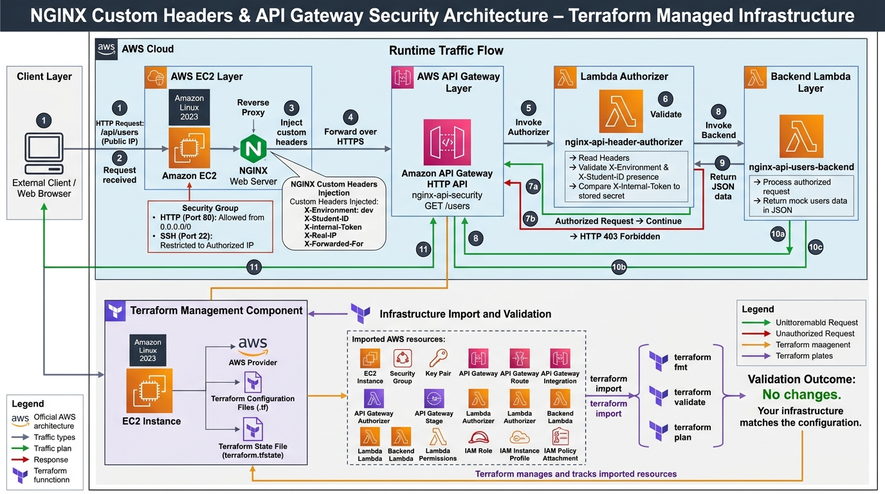

# NGINX Custom Headers & API Gateway Security Architecture

## 1. Project Overview

This project implements a secure API request-forwarding architecture using AWS EC2, NGINX, Amazon API Gateway, and AWS Lambda Authorizer.

NGINX acts as a reverse proxy, forwarding incoming HTTP requests to Amazon API Gateway while injecting custom HTTP headers.

API Gateway uses a Lambda Authorizer to validate incoming headers before allowing requests to reach the backend Lambda function.

The infrastructure is managed and documented using Terraform.

## 2. Project Objectives

- Deploy an NGINX reverse proxy on Amazon EC2.
- Configure NGINX to forward API requests to Amazon API Gateway.
- Inject custom HTTP headers into forwarded requests.
- Implement request authorization using AWS Lambda Authorizer.
- Protect backend API access using header validation.
- Manage AWS infrastructure using Terraform.
- Test successful and unauthorized API requests.

## 3. AWS Architecture



### Architecture Components

| Component | Responsibility |
|---|---|
| Client | Sends HTTP requests |
| Amazon EC2 | Hosts the NGINX server |
| NGINX | Acts as a reverse proxy |
| Amazon API Gateway | Receives and routes API requests |
| Lambda Authorizer | Validates custom HTTP headers |
| Backend Lambda | Returns mock users data |
| AWS IAM | Controls permissions and access |
| Terraform | Manages infrastructure as code |

## 4. Request Flow

1. The client sends an HTTP request to the EC2 public IP.
2. NGINX receives the incoming request.
3. NGINX forwards the request to Amazon API Gateway.
4. NGINX injects the required custom HTTP headers.
5. API Gateway invokes the Lambda Authorizer.
6. The Authorizer validates the request headers.
7. If validation fails, API Gateway returns HTTP 403 Forbidden.
8. If validation succeeds, API Gateway forwards the request to the backend Lambda.
9. The backend Lambda processes the request and returns JSON data.
10. The response travels back through API Gateway and NGINX to the client.

## 5. NGINX Configuration

NGINX is configured as a reverse proxy.

The configuration forwards requests under:

`/api/`

to the API Gateway endpoint.

### Custom Headers

| Header | Description |
|---|---|
| X-Environment | Identifies the deployment environment |
| X-Student-ID | Identifies the student/project owner |
| X-Internal-Token | Internal authorization token |
| X-Real-IP | Original client IP address |
| X-Forwarded-For | Preserves forwarding IP information |

### Example NGINX Configuration

The repository contains a sanitized example:

`docs/nginx/api-gateway.conf.example`

Actual internal tokens and sensitive values are intentionally excluded.

## 6. Amazon API Gateway

An HTTP API was created using Amazon API Gateway.

### API Configuration

- API Type: HTTP API
- API Name: nginx-api-security
- Route: `GET /users`
- Integration: AWS Lambda
- Stage: `$default`
- Auto Deploy: Enabled

API Gateway acts as the entry point between NGINX and the backend Lambda function.

## 7. AWS Lambda Authorizer

The Lambda Authorizer protects the API endpoint by validating custom request headers.

### Authorization Requirements

The request must satisfy the following conditions:

1. `X-Environment` must equal `dev`.
2. `X-Student-ID` must not be empty.
3. `X-Internal-Token` must match the configured Lambda environment variable.

### Authorization Results

| Condition | Result |
|---|---|
| All required headers are valid | Authorized |
| Environment header is invalid | Unauthorized |
| Student ID is missing | Unauthorized |
| Internal token is invalid | Unauthorized |

Unauthorized requests are rejected with HTTP 403.

## 8. Backend Lambda Function

The backend Lambda function returns mock users data in JSON format.

### Sample API Response

```json
{
  "success": true,
  "message": "Users retrieved successfully",
  "users": [
    {
      "id": 1,
      "name": "Mohamed",
      "role": "Cloud Engineer"
    },
    {
      "id": 2,
      "name": "Ahmed",
      "role": "DevOps Engineer"
    },
    {
      "id": 3,
      "name": "Sara",
      "role": "Software Engineer"
    }
  ]
}
```

## 9. Security Configuration

The project applies several security practices:

- SSH access is restricted to a specific CIDR range.
- HTTP traffic is allowed through port 80.
- Custom headers are injected by NGINX.
- Lambda Authorizer validates incoming requests.
- Internal tokens are not committed to GitHub.
- Terraform state files are excluded from source control.
- Terraform variable files are excluded from source control.
- The repository contains only a sanitized NGINX configuration example.

## 10. Infrastructure as Code – Terraform

Terraform is used to define and manage the AWS infrastructure.

### Terraform Resources

- EC2 Instance
- EC2 Security Group
- EC2 Key Pair
- API Gateway HTTP API
- API Gateway Integration
- API Gateway Route
- API Gateway Stage
- Lambda Authorizer
- Backend Lambda Function
- Lambda Permissions
- IAM Roles
- IAM Policies and Attachments

### Terraform Validation

Format the Terraform files:

```bash
terraform fmt -recursive
```

Validate the configuration:

```bash
terraform validate
```

Review the execution plan:

```bash
terraform plan
```

### Validation Result

The Terraform configuration was successfully formatted and validated.

The final Terraform plan reported:

`No changes. Your infrastructure matches the configuration.`

This confirms that the Terraform configuration matches the currently managed infrastructure.

## 11. Testing and Results

The architecture was tested using HTTP requests.

| Test Case | Expected Result | Actual Result |
|---|---|---|
| Valid request with required headers | HTTP 200 OK | Passed |
| Invalid authorization headers | HTTP 403 Forbidden | Passed |
| Unknown API route | HTTP 404 Not Found | Passed |

### Test Summary

- Successful API forwarding was verified.
- Custom headers were successfully forwarded.
- Lambda Authorizer validation was verified.
- Unauthorized requests were rejected.
- Backend Lambda successfully returned JSON data.

## 12. Repository Structure

```text
terraform-nginx-security/
│
├── docs/
│   ├── nginx/
│   │   └── api-gateway.conf.example
│   └── architecture.png
│
├── lambda/
│   ├── authorizer/
│   │   └── index.mjs
│   └── backend/
│       └── index.mjs
│
├── api-gateway.tf
├── ec2.tf
├── iam.tf
├── key-pair.tf
├── lambda.tf
├── lambda-permissions.tf
├── main.tf
├── security-group.tf
├── variables.tf
│
├── lambda-authorizer.zip
├── lambda-backend.zip
│
├── .gitignore
└── README.md
```

## 13. Deployment Requirements

Before reusing this Terraform configuration:

1. Install Terraform.
2. Configure AWS CLI credentials.
3. Select the appropriate AWS region.
4. Review AWS-specific resource IDs and ARNs.
5. Configure the required Terraform variables.
6. Configure the Lambda internal token securely.
7. Review the Terraform plan before applying changes.

Example variable configuration:

```hcl
ssh_allowed_cidr = "YOUR_PUBLIC_IP/32"
```

Do not commit `terraform.tfvars` or Terraform state files.

## 14. Important Security Notes

- Never publish private SSH keys.
- Never publish internal authorization tokens.
- Never commit Terraform state files.
- Never commit real environment variable files.
- Replace account-specific resource identifiers before reusing the project.
- Review AWS resource costs before deploying or leaving resources running.

## 15. Project Conclusion

This project demonstrates how to build a secure API request-forwarding architecture using NGINX, Amazon API Gateway, and AWS Lambda Authorizer.

It combines reverse proxy configuration, custom HTTP headers, serverless authorization, AWS infrastructure, and Terraform Infrastructure as Code.

The implementation successfully demonstrates secure request forwarding, header validation, and backend API protection.

---

**Project:** NGINX Custom Headers & API Gateway Security Architecture

**Category:** AWS Cloud Computing | DevOps | Infrastructure as Code
